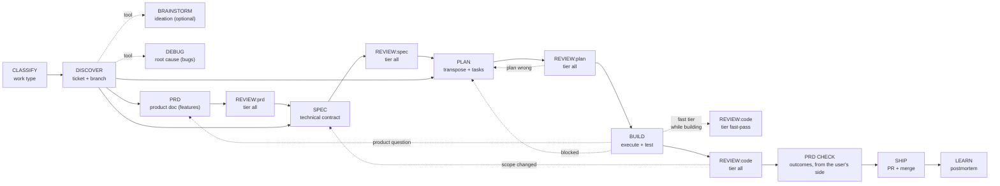
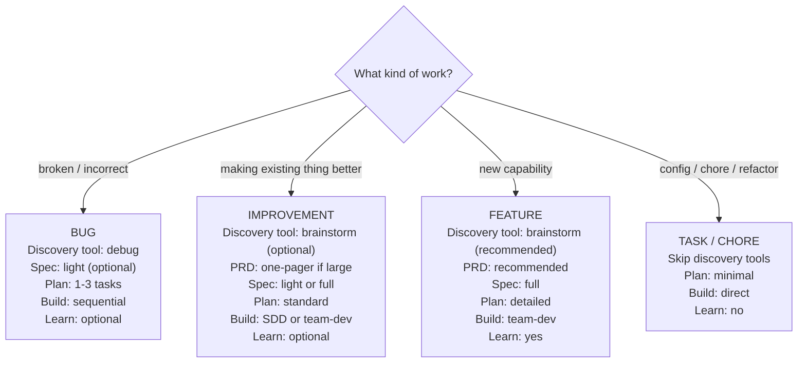

# Jig Development Pipeline

**PURPOSE**: The pipeline orchestrator. Routes work through stages and checks gates at each transition. **Kickoff does NOT execute stages itself** — it invokes the downstream skill for each stage using the Skill tool.

**ORCHESTRATOR RULE**: At every stage transition, you MUST invoke the downstream skill using the Skill tool (e.g., `Skill: jig:plan`). Do NOT attempt to execute the stage inline by following kickoff's summary of what the stage does. The downstream skill has the full process — kickoff only knows enough to route and check gates.

**CONFIGURATION**: Reads `jig.config.md` for pipeline stages, work type overrides, ticket system, branching format, and concerns checklist.

---

## When to Use

Invoke this skill when:
- Starting development work of any kind
- "I need to add/fix/build/improve..."
- "Let's work on [ticket]"
- "There's a bug in..."
- Beginning a new session with a development task
- You want the full pipeline, not just one stage

**Do NOT use when** you only need a single stage (e.g., just creating a PR → use `pr-create` directly).

---

## Terminology

| Term | Meaning |
|------|---------|
| **SDD** | Subagent-Driven Development (`sdd`) — sequential execution, one task at a time |
| **Team-dev** | `team-dev` — parallel execution with agent teams in split panes + two-stage quality gates |

## The Pipeline



Each stage has a **gate**. You don't move forward until the gate is satisfied.

`BRAINSTORM` and `DEBUG` are **discovery-time tools**, not stages — they hang off `DISCOVER` and are invoked on demand (by the user or offered by kickoff) when the work benefits from exploration or root-cause investigation. They produce understanding, not artifacts, and return control to the workflow when done.

`REVIEW` is a **multi-stage gate engine**: it runs after PRD, after SPEC and after PLAN (`tier: all`), and during/after BUILD (`tier: fast-pass` per-task during, `tier: all` pre-ship). The same skill, four modes: `prd`, `spec`, `plan`, `code`. See `core/skills/review/SKILL.md`.

**The PRD is a live document.** When it is published as an artifact, every later stage keeps it current: `spec` opens decisions it finds, `build` ticks milestones and writes to the log, the PRD check fills in the trace, and `finish` ticks the ship milestone. See `framework/LIVE_PRD.md`. When the PRD is a plain `*-prd.md`, the same updates are written into the file (file mode). With no PRD, they are skipped.

The pipeline stages and work type overrides are configurable in `jig.config.md`. Read the config at the start of each session to determine which stages to run.

---

## Step 1: Classify the Work

Before anything else, determine the work type. This controls pipeline depth.



Check `jig.config.md` for stage overrides per work type. The config may skip or lighten stages beyond these defaults.

Ask the user if the type isn't obvious from context.

---

## Step 2: DISCOVER

**Gate**: A ticket exists and the problem is understood.

### Actions

1. **Check for existing ticket**:
   - Branch name contains a ticket reference? Look it up.
   - User mentioned a ticket? Fetch it.
   - No ticket? Create one. Check `jig.config.md` for `ticket-system` (Linear, Jira, GitHub Issues) and use the appropriate tool.

2. **Understand the problem**:
   - Read the ticket description and acceptance criteria.
   - For bugs: check error tracking, reproduce if possible.
   - For features: confirm scope with the user if ambiguous.

3. **Set up the branch**:
   Read branching format from `jig.config.md`:
   ```bash
   git checkout -b {format from config}
   ```

### Gate Check

Before proceeding, confirm:
- [ ] Ticket exists with clear acceptance criteria
- [ ] Branch follows the team's naming convention
- [ ] Problem is understood (not just the title — the actual problem)

---

## Step 2b: PRD (features, large improvements)

**Gate**: An approved PRD exists, or the user opted to skip.

For **features**, prompt: "Want to write the PRD first with `/prd`? It's the plain-language version people can read, tick off and sign." For **large improvements**, offer the one-pager PRD. A PM may already have one: accept a PRD file path or a PRD artifact link and skip authoring.

If yes: **INVOKE `jig:prd` using the Skill tool.** Do not write the PRD inline. The `prd` skill has the full process (interview, phases and MVP cut, the Jig page, the live log). Wait for it to complete before proceeding.

For **bugs**, **tasks**, and **small improvements**: skip this step. Users can still invoke `/prd` manually.

### Gate Check

- [ ] PRD saved (`{plans-directory}/YYYY-MM-DD-<topic>-prd.md`) and, where artifacts are available, published as a live page; OR user opted to skip
- [ ] The PRD has a one-sentence thesis, phases with an MVP cut line, and outcome IDs (`MVP.1` ...)
- [ ] Every sign-off listed for the current rev is recorded, or the user chose to proceed while sign-off is pending

---

## Step 2c: SPEC

**Gate**: A spec exists for the phase being built, or the user opted to skip.

For **features** and **improvements**: **INVOKE `jig:spec` using the Skill tool.** If a PRD exists, pass its path or artifact link: "PRD is at `...`. Spec the MVP phase." The `spec` skill has the full process (tier selection, 12-section structure, acceptance checklist format, PRD tracing).

For **bugs**: offer the light spec when the fix touches more than one layer; otherwise skip. For **tasks**: skip.

### Gate Check

- [ ] Spec saved to the path resolved from `jig.config.md` (`plans-directory` + `filename-format`, default `docs/plans/YYYY-MM-DD-<topic>-spec.md`) OR user opted to skip
- [ ] If the spec exists, its acceptance checklist has `[ ]` items tagged by layer
- [ ] If a PRD exists, every in-scope PRD outcome is served by at least one spec item

---

## Discovery Tools (optional, on-demand)

During or after DISCOVER, the user may benefit from one of two discovery-time tools. Offer them when appropriate; never force them.

### Brainstorm

Offer for: features with unclear scope, improvements where approach isn't obvious, any time the user signals "I'm not sure how to approach this."

**Skip for:** tasks with obvious scope, bugs where the fix is clear from the ticket.

If user accepts, **INVOKE `jig:brainstorm` using the Skill tool.** It returns control to kickoff when done — no auto-handoff to plan.

### Debug

Offer for: bugs where the root cause isn't obvious from the ticket.

If user accepts, **INVOKE `jig:debug` using the Skill tool.** It returns control to kickoff when done.

### Gate Check

These are tools, not stages. There's no gate — the user moves on when they're ready. Kickoff proceeds to the next stage (PRD, SPEC or PLAN) when the user signals readiness.

---

## Step 4: PLAN

**Gate**: A numbered plan exists with tasks, files, and verification steps.

**INVOKE `jig:plan` using the Skill tool.** The `plan` skill's Step 1 is TRANSPOSE — it distills the available source (spec, ticket, conversation) into a layered contract, derives file structure, sequences by dependency, and decomposes into TDD bite-sized tasks. Kickoff does not transpose; it hands off.

If a spec was created in Step 2c, mention it (and the PRD, if any) when invoking: "Spec is at `{plans-directory}/YYYY-MM-DD-<topic>-spec.md`. PRD is at `...`." Otherwise plan will transpose from the ticket + conversation context.

### Gate Check

Before proceeding, confirm:
- [ ] Plan reviewed and approved by the user
- [ ] Tasks have clear file paths and skill references
- [ ] Dependencies identified
- [ ] Plan saved to the path resolved from `jig.config.md` (`plans-directory` + `filename-format`)
- [ ] Every contract item (spec `[ ]` or inline) maps to at least one task
- [ ] If a PRD exists, the plan has a Milestone Map

---

## Step 5: BUILD

Stage key in `jig.config.md`: `execute` (kept from 1.x so existing configs work).

**Gate**: All tasks implemented, tested, and committed.

**INVOKE `jig:build` using the Skill tool.** Pass the plan path: "Execute the plan at `{plans-directory}/<resolved-filename>-plan.md`" (resolve `plans-directory` and `filename-format` from `jig.config.md`). The `build` skill analyzes the task graph and auto-selects parallel (`team-dev`) or serial (`sdd`) execution. Do not choose the strategy yourself.

### Gate Check

Before proceeding, confirm:
- [ ] All tasks from the plan are implemented
- [ ] Tests pass (as specified in plan)
- [ ] Changes committed with proper messages
- [ ] Project builds successfully

---

## Step 6: REVIEW

**Gate**: Code passes self-audit and automated review.

**INVOKE `jig:review` using the Skill tool.** The `review` skill dispatches the specialist swarm (security, dead code, error handling, async safety, performance + team specialists), scores findings, and produces a unified report. Fix any Critical or Major issues before proceeding.

### Gate Check

Before proceeding, confirm:
- [ ] Self-audit checklist passed
- [ ] No Critical issues in review report
- [ ] All Major issues addressed or acknowledged

---

## Step 6b: PRD CHECK (when a PRD exists)

Stage key in `jig.config.md`: `prd-check`. Skip this step if the config's `stages` list leaves it out.

**Gate**: Every in-scope PRD outcome is verified from the user's side, or explicitly deferred.

**INVOKE `jig:prd` using the Skill tool in check mode** ("Check the PRD at `...` against the build"). The spec reviewer already asked "did we build what the spec says"; this asks "can a person now do what the PRD promised". The `prd` skill walks each in-scope outcome's "you'll know it works when" line, records proof or a gap, and fills in the PRD's trace. On a live PRD, it writes the results to the trace and the log.

### Gate Check

- [ ] Every in-scope outcome is `verified` with proof, or deferred with a reason the PRD owner accepted
- [ ] No outcome is marked `built` without being watched working

---

## Step 7: SHIP

**Gate**: PR created and merged.

1. **Commit**: Invoke the `jig:commit` agent (Agent tool with `subagent_type: "jig:commit"`)
2. **Create PR**: **INVOKE `jig:pr-create` using the Skill tool.** It runs the review swarm, analyzes commits, and creates the PR.
3. **Address feedback**: **INVOKE `jig:pr-respond` using the Skill tool** for any reviewer comments.
4. **Merge**: After approval
5. **Live PRD**: `finish` ticks any milestone the merge completes and logs the PR link (see `framework/LIVE_PRD.md`)

### Gate Check

- [ ] PR created with clear description
- [ ] Ticket referenced (per `jig.config.md` settings)
- [ ] CI passes
- [ ] Reviewer approval received

---

## Step 8: LEARN (features only, optional for others)

**INVOKE `jig:postmortem` using the Skill tool.** It runs Jig's learning loop (`framework/LEARNING_LOOP.md`) on the merged PR's review comments and anything else learned during the work: it routes each lesson to one home, applies it, and reviews its fit with Jig. This is how Jig improves itself.

---

## Stage Transitions

The pipeline enforces ordering. Here's the complete transition map:

```
CLASSIFY
  └──> DISCOVER (always)
         ├╌╌╌> BRAINSTORM (optional tool, returns to DISCOVER)
         ├╌╌╌> DEBUG (optional tool, returns to DISCOVER)
         │
         ├──> PRD (features, large improvements)
         │    └──> REVIEW:prd → SPEC
         │
         ├──> SPEC (features, improvements; light for bugs)
         │    └──> REVIEW:spec → PLAN
         │
         └──> PLAN (always — transposes whatever source is available)
                └──> REVIEW:plan → BUILD
                       └──> REVIEW:code (fast, per-task during build)
                              └──> REVIEW:code (full, pre-ship)
                                     └──> PRD CHECK (when a PRD exists)
                                            └──> SHIP
                                                   └──> LEARN (features, complex improvements)
```

### Looping Back

The pipeline isn't strictly linear. You may loop back when:

- **Plan is wrong** → Return to Plan, revise tasks
- **Scope changed during execution** → Return to Spec (or Brainstorm), update the contract
- **Build hits a product question** → Open a decision on the PRD; pause only the tasks it blocks
- **Review finds design issues** → Return to Plan or Brainstorm depending on severity
- **PR feedback requires significant changes** → Return to Build

When looping back, update the plan document to reflect changes.

---

## Common Mistakes

| Mistake | Consequence | Fix |
|---------|------------|-----|
| Skipping Discover | No ticket, no branch convention, no tracking | Always start with the ticket |
| Skipping the PRD for features | Nobody outside engineering can read or sign the scope | Run `/prd`, or accept the PM's PRD link |
| Skipping the spec | Acceptance criteria discovered mid-implementation | Run `/spec` before planning |
| Skipping Plan for "simple" features | Can't parallelize, ad-hoc execution | Even 2-task plans help |
| Skipping Review | AI-generated bugs ship to production | Self-audit is non-negotiable |
| Skipping Learn | Same review feedback on every PR | Run postmortem on complex features |
| Starting with code | "Add a button" without understanding the requirement | Discover first, always |
| Forcing brainstorm before plan | Workflow friction; brainstorm is an optional tool | Offer brainstorm during DISCOVER; never gate plan on it |
| Skipping the TRANSPOSE step | Plan misses contract items, tasks don't tie to acceptance criteria | Plan's Step 1 transposes — verify every contract item maps to a task |

---

## Quick Reference

| Stage | Skill Tool Invocation | Output |
|-------|----------------------|--------|
| Classify | (kickoff handles directly) | Work type determined |
| Discover | (kickoff handles directly) | Ticket + branch |
| PRD | `Skill: jig:prd` | Live PRD page + `*-prd.md` |
| Spec | `Skill: jig:spec` | `*-spec.md` with acceptance checklist |
| Brainstorm (tool) | `Skill: jig:brainstorm` | Understanding, no artifact |
| Debug (tool) | `Skill: jig:debug` | Root cause, no artifact |
| Plan | `Skill: jig:plan` | `{plans-directory}/*-plan.md` |
| Build | `Skill: jig:build` | Implemented + tested code |
| Review | `Skill: jig:review` | Audited code |
| PRD check | `Skill: jig:prd` (check mode) | Outcomes verified, trace filled |
| Ship | `Skill: jig:pr-create` | Merged PR |
| Learn | `Skill: jig:postmortem` | Fit-reviewed skill changes |
